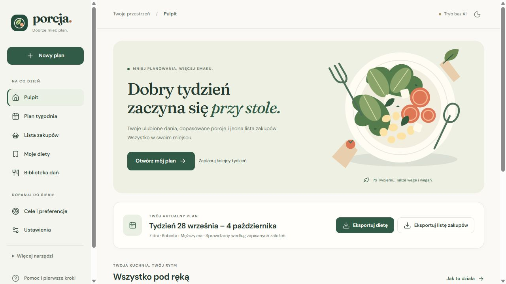
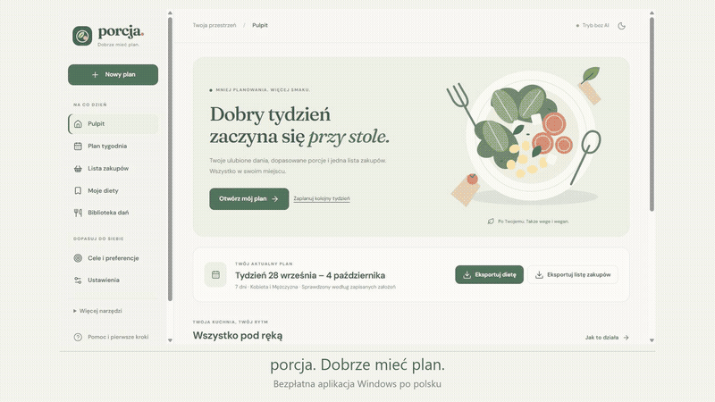
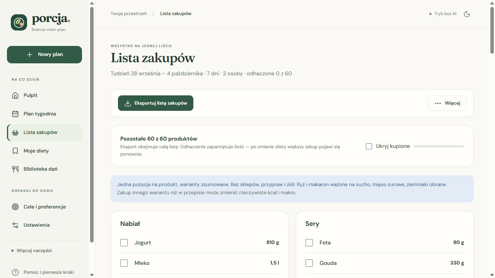

# Porcja · dobrze mieć plan

Tygodniowe menu, dopasowane porcje i jedna lista zakupów. **Bezpłatna aplikacja Windows po polsku**, która działa lokalnie — bez konta, abonamentu i obowiązkowego AI.

**[Pobierz Porcję 0.3.0 dla Windows](https://github.com/krapcys1-maker/dietbot-desktop/releases/download/v0.3.0/Porcja-Setup-0.3.0.exe)** · [Instrukcja](docs/INSTRUKCJA.md) · [Co nowego](CHANGELOG.md) · [Zgłoś problem](https://github.com/krapcys1-maker/dietbot-desktop/issues)

## Zobacz, jak to wygląda

[Obejrzyj lub pobierz film MP4](https://github.com/krapcys1-maker/dietbot-desktop/releases/download/v0.3.0/Porcja-demo-pl.mp4). Prezentacja zmontowana z prawdziwych ekranów wersji 0.3.0, na osobnym przykładowym profilu. Napisy po polsku, bez dźwięku. Nie zawiera prywatnych diet ani kluczy API.

## Od instalacji do pierwszego tygodnia

1. Pobierz **Porcja-Setup-0.3.0.exe** z [oficjalnego wydania](https://github.com/krapcys1-maker/dietbot-desktop/releases/tag/v0.3.0), uruchom instalator i otwórz **Porcję** z menu Start.
2. W **Cele i preferencje** sprawdź osoby, cele oraz rodzaj diety. Domyślne ustawienia są przykładem, nie indywidualnym zaleceniem.
3. W **Nowy plan** wybierz tydzień i kliknij **Ułóż mój plan**. Możesz planować bez klucza AI.
4. Otwórz **Plan tygodnia**: przejrzyj posiłki, porcje i ewentualne uwagi. Nie każde połączenie ograniczeń da się spełnić.
5. Kliknij **Eksportuj dietę** albo **Eksportuj listę zakupów**. W aplikacji Windows wybierzesz nazwę i miejsce zapisu pliku TXT — eksport obejmuje cały wybrany plan, nie tylko widoczny dzień.

Wymagania: Windows 10/11 x64 i Microsoft Edge WebView2 Runtime. Instalacja dla bieżącego użytkownika, bez uprawnień administratora. Python i Node.js nie są potrzebne do korzystania z instalatora.

> Instalator nie jest podpisany certyfikatem. Windows może wyświetlić ostrzeżenie SmartScreen. Sprawdź źródło pliku i sumę SHA-256 dostępną w wydaniu; nie wyłączaj zabezpieczeń systemu.

## Co potrafi Porcja

| Funkcja | Jak pomaga |
|---|---|
| Plan tygodnia | Wspólne dania z osobnymi gramaturami dla osób zapisanych w konfiguracji; domyślnie dwie osoby. |
| Kalorie i makro | Kcal, białko, tłuszcze i węglowodany obliczane z gramatur i tabel produktów, z niezależnym weryfikatorem. |
| Diety tradycyjna, wege i wegan | Wybór wspólny dla całego planu; zgodność sprawdzana na poziomie składników, także przekąsek i stałych pozycji. |
| Biblioteka dań | Ponad 680 zatwierdzonych dań w bazie startowej, wyszukiwarka, filtry diety, ocen i czasu do 15 minut. |
| Twoje upodobania | „Lubię” zwiększa szansę wyboru, „Nie lubię” wyklucza danie z nowych planów i zamian. Oceny są wspólne dla domowników. |
| Moje diety | Zapis nazwanych tygodni, historia i powrót do wcześniejszych wersji. Nowe plany zachowują własne dane źródłowe do obliczeń. |
| Proste zakupy | Połączone warianty produktów, bez dopisków sklepów, marek, przypraw i ziół. Odhaczanie kupionych ilości. |
| Dwa eksporty | Osobno cały jadłospis z przepisami i gramaturami oraz cała lista zakupów do TXT. |
| Opcjonalny kalkulator celów | Propozycja kcal i makro na podstawie wieku, wzrostu, masy, płci używanej we wzorze i aktywności. Można pozostać przy ręcznych celach. |
| Własny DeepSeek | Opcjonalny czat, interpretacja życzeń i proponowanie nowych dań. Klucz wpisujesz w Ustawieniach. |
| Czytelny interfejs | Pulpit, jasny i ciemny motyw, przewodnik oraz szczegóły schowane w rozwijanych sekcjach. |

### Zapis w aplikacji czy plik na dysku?

- **Zapisz dietę** — nadaje nazwę i dodaje plan do zakładki **Moje diety**.
- **Eksportuj dietę** — zapisuje pełny plan do pliku TXT.
- **Eksportuj listę zakupów** — zapisuje całą listę, również produkty już odhaczone.

## Bezpłatna aplikacja, opcjonalne AI

Porcja nie wymaga abonamentu ani klucza API do podstawowego planowania. Jeśli chcesz korzystać z AI, dodaj swój klucz w **Ustawienia → Twój pomocnik AI → Zapisz klucz**.

**Opłaty za DeepSeek rozliczasz u dostawcy na własnym koncie.** Budżet i szacunki w aplikacji nie są gwarancją rachunku dostawcy. Bez klucza nie działają czat, rozumienie swobodnych życzeń i wymyślanie nowych dań przez model.

## Dane i prywatność

- Plany, oceny i ustawienia znajdują się na Twoim komputerze. Brak konta Porcji, telemetrii i synchronizacji w chmurze.
- Przy włączonym AI odpowiedni kontekst zadania jest wysyłany do DeepSeek. Opcjonalny Telegram korzysta z usługi Telegram.
- Klucz API jest lokalnie zapisany **jawnym tekstem w pliku `.env`**, nie w bezpiecznym magazynie Windows. Nie udostępniaj folderu danych.
- Instalator i repozytorium nie zawierają Twojego klucza ani prywatnej bazy planów.
- Dane wersji instalowanej: `%LOCALAPPDATA%\DietBot`. Nazwa techniczna `DietBot.exe` i ten katalog pozostają dla zgodności z wcześniejszymi wersjami.

Szczegóły kopii zapasowej, aktualizacji i usuwania klucza: [instrukcja](docs/INSTRUKCJA.md).

## Co oznaczają liczby i status planu?

Kalorie to suma wartości **kcal/100 g z bazy × gramatura/100**. Białko, tłuszcze i węglowodany liczone są osobno z tych samych produktów. Aplikacja nie podmienia kalorii skrótem 4×B + 9×T + 4×W.

Źródła są zapisane przy produktach: m.in. BLS 4.0, etykiety i Open Food Facts. Obliczenia są zgodne z danymi użytymi w planie, co **nie oznacza laboratoryjnej dokładności konkretnego produktu ze sklepu**. Przyprawy oznaczone jako pomijalne nie wchodzą do sum.

„Zgodny z założeniami” oznacza zgodność z regułami sprawdzanymi przez aplikację — nie pełną ocenę zdrowotną. Uproszczona lista zakupów łączy warianty, np. mozzarelli; kupienie innego wariantu niż w przepisie może zmienić rzeczywiste makro.

**Porcja nie jest wyrobem medycznym ani zamiennikiem lekarza lub dietetyka.** Nie bilansuje wszystkich witamin, minerałów i alergenów. Kalkulator jest orientacyjny i ma ograniczenia; [metodę i granice opisano w instrukcji](docs/INSTRUKCJA.md#kalkulator-celów). Przy szczególnych potrzebach żywieniowych używaj indywidualnie ustalonych celów i sprawdzaj etykiety.

## Rozwój i dokumentacja

Porcja to nowa nazwa DietBota. Projekt jest we wczesnej fazie rozwoju; adres repozytorium pozostaje bez zmian.

- [Instrukcja użytkownika i FAQ](docs/INSTRUKCJA.md)
- [Uruchamianie ze źródeł, testy i budowanie instalatora](docs/ROZWOJ.md)
- [Historia zmian](CHANGELOG.md)
- [Architektura](docs/ARCHITEKTURA.md) · [źródła danych i research](docs/RESEARCH.md)
- [Plan dalszego rozwoju](docs/PLAN_ROZWOJU_2026-09-27.md)
- [Materiały graficzne i licencje](docs/PORCJA_0.3.0.md#materiały-i-licencje)

Zgłoszenia i propozycje po polsku są mile widziane. Podaj wersję, kroki odtworzenia i oczekiwany wynik. **Nie dołączaj klucza API, `.env`, prywatnej bazy ani danych zdrowotnych.**

Kod jest publicznie dostępny; repozytorium nie ma jeszcze odrębnej licencji na własny kod. Bezpłatne udostępnienie aplikacji nie oznacza automatycznie licencji MIT. Zależności, fonty, ikony i dane źródłowe zachowują własne warunki — informacje o nich znajdują się w dokumentacji i dołączonych plikach licencji.
