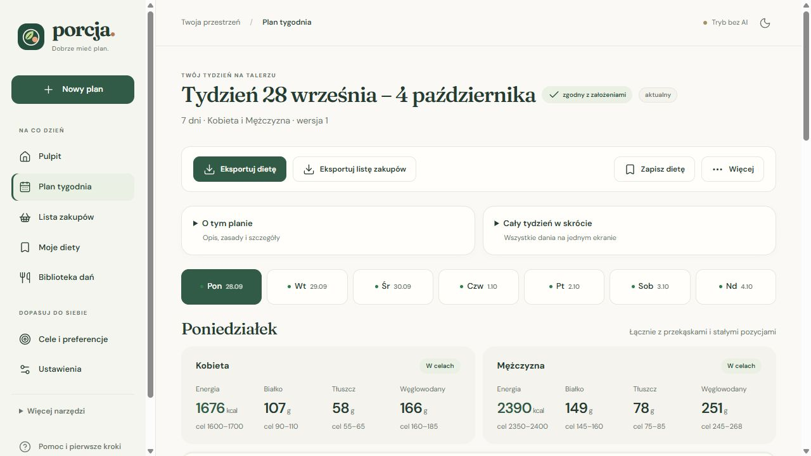
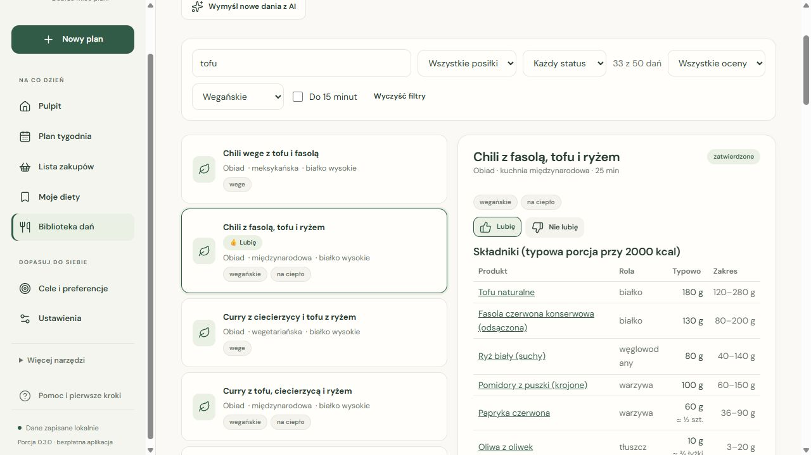
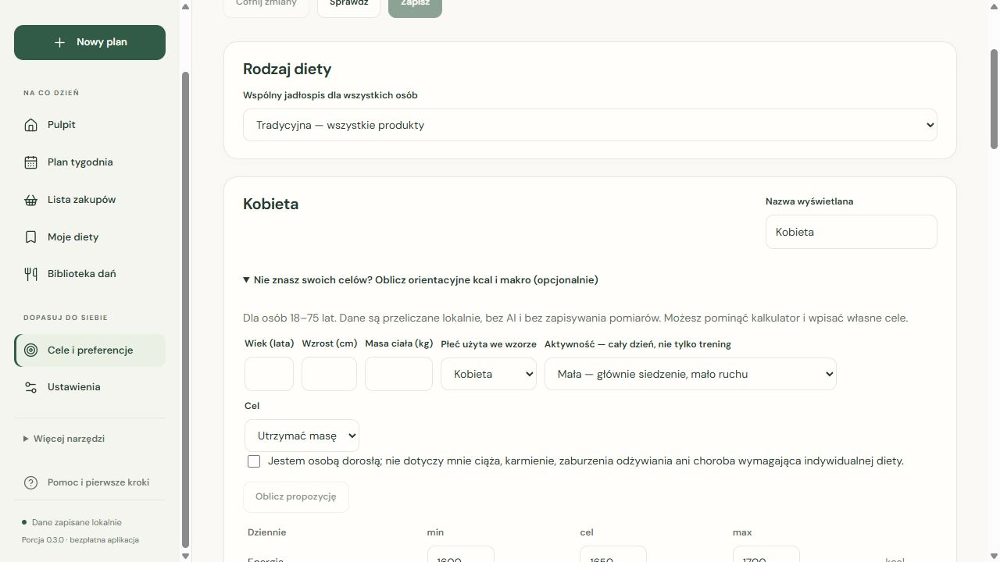
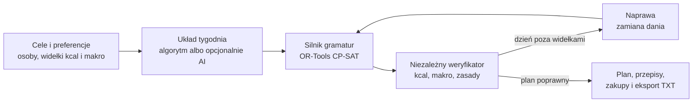

  

<h1 align="center">Porcja · dobrze mieć plan</h1>

  Tygodniowe menu dla całego domu, porcje dopasowane do celów każdej osoby i jedna lista zakupów. 
  <b>Bezpłatna aplikacja Windows po polsku.</b> Działa lokalnie — bez konta, abonamentu i obowiązkowego AI.

  
  
  
  

  <a href="https://github.com/krapcys1-maker/dietbot-desktop/releases/download/v0.5.1/Porcja-Setup-0.5.1.exe"><b>Pobierz Porcję 0.5.1 dla Windows</b></a>
  · <a href="docs/INSTRUKCJA.md">Instrukcja</a>
  · <a href="CHANGELOG.md">Co nowego</a>
  · <a href="https://github.com/krapcys1-maker/dietbot-desktop/issues">Zgłoś problem</a>

## Co potrafi Porcja

| Funkcja | Jak pomaga |
|---|---|
| **Plan tygodnia** | Wspólne dania, a dla każdej osoby osobne gramatury. Domyślnie dwie osoby; śniadanie, obiad i kolacja. |
| **Kalorie i makro** | Kcal, białko, tłuszcze i węglowodany liczone z gramatur i tabel produktów — i sprawdzane drugi raz przez niezależny weryfikator. |
| **Tradycyjna, wege i wegan** | Wybór dla całego planu, sprawdzany na poziomie składników — także przekąsek i stałych pozycji (np. napój sojowy zamiast mleka do kawy). |
| **Biblioteka dań** | Blisko 700 zatwierdzonych przepisów z 13 kuchni, w tym ponad 50 wegańskich. Wyszukiwarka, filtry diety, ocen i dań do 15 minut. |
| **Gotowanie na zapas** | Zupa na wtorek i środę: jedna tabela ilości na całą partię i przepis wykonywany raz; drugiego dnia tylko odgrzewasz. |
| **Twoje upodobania** | „Lubię” zwiększa szansę wyboru, „Nie lubię” wyklucza danie z nowych planów i zamian. |
| **Notatnik preferencji** | Piszesz uwagę („za dużo ryżu na obiad, wolę więcej mięsa”, „nie dawaj białek jaj”), a Porcja zapisuje z niej zasady: zakaz produktu, limit porcji na osobę, mniej węglowodanów kosztem białka. Liczby bierze z Twoich słów albo liczy sama. Analiza nawyków podpowiada kolejne zasady. Uwagi do działania aplikacji trafiają na osobną listę dla twórcy. |
| **Moje diety** | Nazwane tygodnie, historia i wersje. Zapisany plan zachowuje dane, z których go policzono. |
| **Proste zakupy** | Połączone warianty produktów, bez marek, przypraw i ziół. Odhaczanie kupionych ilości. Eksport bez znaczników listy — wklejasz do notatek w telefonie i od razu masz listę do odhaczania. |
| **Dwa eksporty** | Cały jadłospis z przepisami i gramaturami oraz cała lista zakupów — do plików TXT. |
| **Kalkulator celów** | Opcjonalna, orientacyjna propozycja kcal i makro z wieku, wzrostu, masy i aktywności. |
| **Własny DeepSeek (opcja)** | Czat, życzenia pisane zwykłym językiem („w piątek pizza, bez ryb”) i wymyślanie nowych dań. Płatne akcje czekają na potwierdzenie, a jedno polecenie ma limit kosztu. |

<table>
  <tr>
    <td width="50%"></td>
    <td width="50%"></td>
  </tr>
  <tr>
    <td align="center">Plan tygodnia: bilans dnia dla każdej osoby</td>
    <td align="center">Lista zakupów na cały tydzień</td>
  </tr>
  <tr>
    <td></td>
    <td></td>
  </tr>
  <tr>
    <td align="center">Biblioteka dań z filtrami i ocenami</td>
    <td align="center">Cele, rodzaj diety i kalkulator</td>
  </tr>
</table>

**Film:** [krótka prezentacja MP4](https://github.com/krapcys1-maker/dietbot-desktop/releases/download/v0.3.0/Porcja-demo-pl.mp4) (1,8 MB, polskie napisy, bez dźwięku) — zmontowana z ekranów wersji 0.3.0 na przykładowym profilu.

## Od instalacji do pierwszego tygodnia

1. Pobierz **Porcja-Setup-0.5.1.exe** z [najnowszego wydania](https://github.com/krapcys1-maker/dietbot-desktop/releases/latest), uruchom instalator i otwórz **Porcję** z menu Start.
2. W **Cele i preferencje** sprawdź osoby, cele oraz rodzaj diety. Domyślne ustawienia są przykładem, nie indywidualnym zaleceniem.
3. W **Nowy plan** wybierz tydzień i kliknij **Ułóż mój plan** — zwykle 20–60 sekund, bez klucza AI.
4. Otwórz **Plan tygodnia**: przejrzyj posiłki, porcje i ewentualne uwagi. Danie możesz zamienić albo ocenić.
5. Kliknij **Eksportuj dietę** albo **Eksportuj listę zakupów** i wybierz miejsce zapisu pliku TXT. Eksport obejmuje cały plan, nie tylko widoczny dzień.

Wymagania: Windows 10/11 x64 i Microsoft Edge WebView2 Runtime (zwykle już zainstalowany). Instalacja dla bieżącego użytkownika, bez uprawnień administratora. Python i Node.js nie są potrzebne.

> Instalator nie jest podpisany certyfikatem, więc Windows może pokazać ostrzeżenie SmartScreen. Pobieraj go tylko z oficjalnych wydań i porównaj sumę SHA-256 z pliku `SHA256SUMS.txt` w wydaniu. Nie wyłączaj zabezpieczeń systemu.

## Jak to działa

Najważniejsza zasada: **liczby liczy kod, nie AI.** Model językowy (jeśli go włączysz) może zaproponować dania i napisać opis tygodnia, ale nigdy nie podaje kalorii ani gramów.

1. **Układ tygodnia.** Z biblioteki wybierane są dania pasujące do zasad: rodzaj diety, oceny, brak powtórek z ostatnich tygodni, zupa na zapas, limit słodkich kolacji i posiłków „z puli 20%”.
2. **Gramatury.** Silnik CP-SAT dobiera gramatury w krokach możliwych do odważenia (np. co 5–10 g, na sztuki albo kromki) tak, by każda osoba zmieściła się w swoich widełkach kcal, białka, tłuszczu i węglowodanów. Pilnuje realnych porcji i proporcji przepisu — np. ciasto naleśnikowe albo panierka są skalowane razem, a tost ma parzystą liczbę kromek.
3. **Weryfikacja.** Osobny moduł przelicza cały plan od zera z tabel produktów. Jeśli coś się nie zgadza, planer wymienia problematyczne danie i liczy ponownie; gdy nie da się spełnić celów, plan dostaje czytelne uwagi zamiast „cichego” wyniku.
4. **Wynik.** Jadłospis z przepisami, bilansem każdego dnia i całego tygodnia oraz lista zakupów z połączonymi wariantami produktów.

Szczegóły: [architektura](docs/ARCHITEKTURA.md) · [źródła danych i research](docs/RESEARCH.md).

## Dane i prywatność

- Plany, oceny i ustawienia są na Twoim komputerze (`%LOCALAPPDATA%\DietBot`). Brak konta Porcji, telemetrii i synchronizacji w chmurze.
- Bez klucza AI Porcja nie wysyła Twoich danych do żadnej usługi. Przy włączonym AI odpowiedni kontekst zadania trafia do DeepSeek; opcjonalny bot Telegram korzysta z usługi Telegram.
- Klucz API jest zapisany lokalnie **jawnym tekstem w pliku `.env`**, nie w magazynie Windows. Nie udostępniaj folderu danych.
- Instalator i repozytorium nie zawierają Twojego klucza ani prywatnej bazy planów.
- Nazwa techniczna `DietBot.exe` i katalog danych pozostały dla zgodności ze starszymi wersjami.

**Opłaty za DeepSeek rozliczasz u dostawcy na własnym koncie.** Budżet i szacunki w aplikacji nie są gwarancją rachunku dostawcy. Klucz dodasz w **Ustawienia → Twój pomocnik AI → Zapisz klucz**.

## Co oznaczają liczby i status planu?

Kalorie to suma wartości **kcal/100 g z tabeli × gramatura/100** — aplikacja nie zastępuje ich skrótem 4×B + 9×T + 4×W. Źródło jest zapisane przy każdym produkcie: m.in. [BLS 4.0](https://www.blsdb.de/) (CC BY 4.0), etykiety i Open Food Facts. Obliczenia są zgodne z danymi użytymi w planie, co **nie oznacza laboratoryjnej dokładności konkretnego produktu ze sklepu**. Przyprawy oznaczone jako pomijalne nie wchodzą do sum.

„Zgodny z założeniami” oznacza zgodność z regułami sprawdzanymi przez aplikację — nie pełną ocenę zdrowotną. Uproszczona lista zakupów łączy warianty, np. mozzarelli; kupienie innego wariantu niż w przepisie może zmienić rzeczywiste makro.

**Porcja nie jest wyrobem medycznym ani zamiennikiem lekarza lub dietetyka.** Nie bilansuje wszystkich witamin, minerałów i alergenów. Kalkulator jest orientacyjny; [metodę i ograniczenia opisano w instrukcji](docs/INSTRUKCJA.md#kalkulator-celów). Przy szczególnych potrzebach żywieniowych używaj indywidualnie ustalonych celów i sprawdzaj etykiety.

## Rozwój

Porcja to nowa nazwa DietBota — projekt jest we wczesnej fazie rozwoju, adres repozytorium pozostał bez zmian.

| Warstwa | Technologie |
|---|---|
| Silnik i weryfikator | Python 3.12, OR-Tools CP-SAT, Pydantic 2 |
| Aplikacja | FastAPI (tylko `127.0.0.1`), React 19 + TypeScript + Vite, okno pywebview (WebView2) |
| AI (opcjonalnie) | DeepSeek przez API zgodne z OpenAI — tylko wybór dań i teksty, walidowane kodem |
| Dane | YAML z przepisami i produktami (BLS 4.0, Open Food Facts), SQLite na plany |
| Wydanie | PyInstaller + Inno Setup, GitHub Actions: ruff, pytest i build interfejsu przy każdej zmianie |

- [Uruchamianie ze źródeł, testy i budowanie instalatora](docs/ROZWOJ.md)
- [Jak pomóc w rozwoju](CONTRIBUTING.md) · [bezpieczeństwo](SECURITY.md)
- [Instrukcja użytkownika i FAQ](docs/INSTRUKCJA.md) · [historia zmian](CHANGELOG.md)
- [Plan dalszego rozwoju](docs/PLAN_ROZWOJU_2026-09-27.md) · [materiały graficzne i licencje](docs/PORCJA_0.3.0.md#materiały-i-licencje)

Zgłoszenia i propozycje po polsku są mile widziane. Podaj wersję, kroki odtworzenia i oczekiwany wynik. **Nie dołączaj klucza API, `.env`, prywatnej bazy ani danych zdrowotnych.**

Kod jest publicznie dostępny, ale repozytorium nie ma jeszcze odrębnej licencji na własny kod — bezpłatne udostępnienie aplikacji nie oznacza automatycznie licencji MIT. Zależności, fonty, ikony i dane źródłowe zachowują własne warunki; informacje o nich są w dokumentacji i dołączonych plikach licencji.

## In English

**Porcja** ("portion") is a free, Polish-language Windows app that plans a week of meals for a household: one shared menu, individual portion sizes for each person, recipes, and a combined shopping list. Portions are computed by an integer optimisation engine (Google OR-Tools CP-SAT) so every person lands inside their own calorie and macro ranges, and an independent verifier recomputes every number from food tables (mainly BLS 4.0). An LLM (DeepSeek, bring your own key) is optional and never produces numbers — it only helps pick dishes and write text. Everything runs locally: no account, no telemetry. The UI is Polish only; the dish library (~700 recipes, traditional, vegetarian and vegan) and shopping hints target Poland and Romania.
