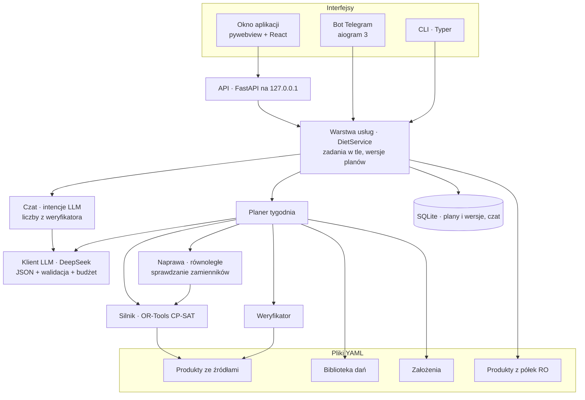

# DietBot — architektura

Wersja 2 · 13.09.2026 · dokument żywy (aktualizujemy przy każdej większej decyzji)

> **Uwaga do wydania publicznego (Porcja).** Dokument opisuje architekturę techniczną z września 2026 i częściowo odzwierciedla pierwotne, prywatne założenia projektu: dwie osoby oraz zakupy w sklepach w Rumunii. W wydaniu publicznym lista zakupów jest uproszczona — łączy warianty produktów i nie pokazuje sklepów ani marek (zob. [historia zmian](../CHANGELOG.md)). Dane półkowe w `dane/sklepy` pozostają w repozytorium jako materiał źródłowy. Opis dla użytkowników: [README](../README.md#jak-to-działa).

## 1. Cel

Aplikacja desktopowa (plus bot Telegram), która układa **tygodniowy jadłospis dla dwóch osób** (Kobieta i Mężczyzna)
według ich celów kcal/makro i zasad z pliku założeń. Oboje jedzą **to samo danie w innych gramaturach**.
Wszystko po polsku; lista zakupów podpowiada produkty z półek sklepów w Rumunii (Lidl RO, Kaufland RO).

## 2. Zasady nadrzędne

1. **Liczby liczy wyłącznie kod.** Gramatury wylicza deterministyczny silnik (CP-SAT), a niezależny weryfikator
   przelicza wszystko jeszcze raz — to jego liczby widzi użytkownik. Model językowy nigdy nie podaje liczb
   odżywczych: wybiera dania, uzasadnia zamiany i rozumie prośby. Walidatory odrzucają jego teksty z cyframi.
2. **Uczciwość zamiast zmyślania.** Plan ma status (poprawny / uwagi / naruszenia). Gdy czegoś nie da się
   spełnić, aplikacja pokazuje najlepszy plan i opisuje, czego brakuje (np. „brak energii 1452 z min. 1600 kcal”).
3. **Założenia są edytowalne** — w aplikacji, w czacie (z potwierdzeniem zmian) albo w pliku YAML.
4. **Każda wartość odżywcza i każda miara domowa ma źródło** (baza + kod wpisu, etykieta z EAN, USDA FDC ID…).
5. **Powtarzalność.** Solver: 1 wątek, stały seed, limit czasu deterministycznego — te same dane dają ten sam plan
   (test w osobnych procesach).
6. **Szeroka biblioteka dań.** Przykładowe jadłospisy użytkownika to próbka gustu, nie granica.

## 3. Wnioski z researchu (skrót)

Szczegóły i źródła: [RESEARCH.md](RESEARCH.md).

- Gotowego rozwiązania nie ma: menedżery przepisów (Mealie, Tandoor, wger) nie optymalizują gramatur, a małe
  optymalizatory liczą dla jednej osoby, bez gotowania na zapas i bez polskiego.
- LLM-y źle liczą kalorie; układ „LLM wybiera, solver liczy, porażka wraca do LLM” działa znacznie lepiej.
- Gramatury całkowite trzeba liczyć w modelu, a nie zaokrąglać po fakcie.
- Tabele składu: **BLS 4.0** (Niemcy, CC BY 4.0) jako główne źródło; polskie tabele IŻŻ/PZH nie mają otwartej licencji.

## 4. Widok z góry



## 5. Model danych

Kod ma angielskie nazwy pól, a pliki danych polskie (aliasy Pydantic).

### 5.1 Produkt (`dane/produkty/*.yaml`)
- `id`, nazwa, aliasy (min. 3 litery, bez duplikatów), kategoria, **stan** (surowy, suchy, gotowany, gotowy do
  jedzenia, odsączony) — wartości na 100 g muszą odpowiadać stanowi z przepisu.
- Na 100 g: kcal, białko, tłuszcz, **węglowodany przyswajalne**, błonnik, cukry, kwasy nasycone, sól, kwasy
  organiczne, poliole (te dwa potrzebne do kontroli kcal wg współczynników UE).
- **Źródło**: BLS / CIQUAL / OFF / etykieta / USDA / ręcznie (z opisem) + kod wpisu, nazwa oryginalna, data.
- Miary domowe ze źródłem (`szt`, `łyżka`, `kromka`, `kulka`, `ząbek`, `szklanka`…), krok gramatury,
  maksymalna porcja, gęstość (ml ↔ g), `pomijalny` (przyprawy poza bilansem).
- Kontrola: kcal z tabeli vs kcal wyliczone z makro wg UE (> 8% → ostrzeżenie).

### 5.2 Produkt z półki (`dane/sklepy/*.yaml`)
Sklep, nazwa na półce (po rumuńsku), marka, EAN, opakowanie w gramach, preferowany, data sprawdzenia, uwagi.
Źródło: Monitorul Prețurilor (Rada Konkurencji Rumunii), strony sklepów, Open Food Facts.

### 5.3 Szablon dania (`dane/dania/*.yaml`)
- Nazwa, opis, posiłki, kuchnia, tagi (`slodkie`, `pula_20`, `na_zapas`, `zupa`, `wege`, `na_cieplo`, `szybkie`),
  kroki, czas, `na_ile_dni` dla dań na zapas, status (szkic / zatwierdzone / odrzucone).
- Składnik: produkt po `id`, **rola** (białko, węglowodany, tłuszcz, warzywa, owoce, nabiał, sos, dodatek,
  przyprawa), **porcjowanie** (`osobno`, `z_garnka` — proporcjonalnie z jednego garnka, `po_rowno`),
  typowa porcja dla 2000 kcal, opcjonalnie min/max, krok, jednostka, `opcjonalny`, `skaluje_sie`.
- Proporcje wewnątrz dania (licznik/mianownik w gramach).
- **Grupy** (`grupy`: nazwa, składniki, opcjonalnie tolerancja) — jedna masa w przepisie: ciasto, panierka, masa
  mielona, farsz, sos, surówka. Udział składnika w masie grupy jest taki jak w typowych gramaturach (domyślnie ±5%,
  duże grupy wygenerowane przez model ±10–15%). Składniki grupy mają to samo porcjowanie, nie są przyprawami ani
  składnikami opcjonalnymi i ważymy je co 1 g.

### 5.4 Założenia (`konfiguracja/zalozenia.yaml`)
- Osoby: widełki dzienne (min, cel, max) kcal i makro, białko na posiłek + tolerancja, wykluczone produkty,
  **maksymalna masa talerza** na posiłek.
- Dzień: posiłki, kolacja lżejsza niż obiad, stałe pozycje (mleko do kawy, kawa, siemię), przekąski (max dziennie,
  dozwolone).
- Tydzień: pula 20% (min–max), maks. słodkich kolacji, dania na zapas (tag, posiłek, dni), bez powtórek.
- Zakazy: produkty, tagi dań w posiłkach, dozwolone źródła węglowodanów, węglowodany wykluczone z kolacji.
- Metoda energii: `etykieta` — suma pola kcal produktów. Stary `makro_4_9_4` jest migrowany przy aktualizacji.

### 5.5 Plan (`wyniki/dietbot.sqlite3`)
Plan tygodnia (dni → posiłki → porcje osób → produkty w gramach, przekąski z powodem, partie na zapas z ilością
„do garnka”), raport weryfikatora, układ dań, dziennik powstawania, życzenia, data tygodnia, koszt LLM.
**Każda zmiana to nowa wersja** (`family_id`, `parent_id`, `version`, notatka zmiany) — nic nie jest nadpisywane.

## 6. Jak powstaje tydzień (`planner/pipeline.py`)

1. **Pule dań (kod)** — twarde filtry: status, zakazy, wykluczenia osób, dozwolone węglowodany, kolacja nie jest
   obiadem, zakres białka osiągalny w daniu vs kotwice. Profil dania dla LLM: źródła białka i węglowodanów,
   „wysokie/średnie/niskie białko”, „lekkie/sycące”, jajka.
2. **Układ tygodnia (LLM)** — na każdy posiłek danie + do 2 zapasowych, wyłącznie identyfikatory z pul;
   krótki komentarz bez liczb (zdania z liczbą albo liczebnikiem kod usuwa — wcześniej odrzucały całą odpowiedź
   i 5 z 46 tygodni układał algorytm zapasowy). Bez LLM: algorytm zapasowy (deterministyczny, z seedem).
3. **Zasady tygodnia (kod)** — sloty, pule, powtórki, pula 20% (posiłki i przekąski z puli, najwyżej jedna rzecz
   dziennie), słodkie kolacje,
   limit dań z jajkami (tydzień i dzień). Zasady „policzalne” kod poprawia sam, wymieniając najmniej dań na
   najbardziej podobne (`planner/autofix.py`); pozostałe błędy wracają do LLM (maks. 3 rundy), potem algorytm zapasowy.
   Wykluczenia z życzeń („bez ryb”) LLM zamienia na kategorie/produkty, a kod usuwa takie dania z pul tego planu.
   Liczby z życzeń („kuchnia włoska 2 razy”) LLM zamienia na liczby kuchni, a kod pilnuje ich dokładnie (walidacja,
   autokorekta z przeszukiwaniem lokalnym po ważonej liczbie naruszeń, naprawa silnika też ich nie zmienia).
   Nowe dania wymyślone na prośbę muszą trafić do tygodnia i naprawa ich nie wyrzuca, jeśli ma inną działającą zamianę.
   **Konkretne dania z życzeń** (`planner/wishes.py`, 14.09.2026): „w 2 dni zupa pomidorowa, w jeden dzień schabowy
   z piersi kurczaka z ziemniakami i surówką” — model wypisuje dania (z poprawionymi literówkami, posiłkiem i dniami),
   kod wybiera z biblioteki kandydatów (słowa życzenia w nazwie ×2, w składnikach ×1, synonimy „schabowy” → kotlet
   w panierce, „z piersi” → kurczak), a model wskazuje wśród nich to, które domownik rozpozna. Brak pasującego dania →
   usługa zamawia je u generatora (walidacja, test silnika, kucharz) i dopisuje do biblioteki. Wybrane danie jest
   przypięte: musi być w tygodniu, w podanym dniu (autokorekta przenosi je na ten dzień), bilans makro i naprawa go nie
   ruszają, a gdy mimo to nie zmieści się w celach, plan dostaje uwagę „danie z życzeń pominięte”. Wcześniej życzenie
   szło do modelu tylko jako tekst — w prawdziwym planie domowników zamiast zupy pomidorowej był krem pomidorowy
   z soczewicą, a zamiast kotleta z kurczaka schab z patelni, choć oba właściwe dania były w bibliotece.
   Przekąska z życzeń („w sobotę lody”, „popcorn do filmu”) szuka wśród przekąsek z puli 20% i zajmuje slot przekąski
   w tym dniu (autokorekta dokłada go, przesuwa na dzień z życzeń i zamiast niej usuwa inną rzecz z puli tego dnia);
   przekąsek nie wymyślamy jako dań. Wymyślone danie z życzeń musi mieć w nazwie co najmniej ⅔ słów życzenia
   (rdzeń albo synonim) — inaczej generator odrzuca propozycję i prosi o poprawkę (test na żywo 14.09.2026:
   „w sobotę lody” trafiło do generatora obiadów i wróciło jako kotlet schabowy).
   Model dostaje zróżnicowaną próbkę ok. 50 dań na posiłek (proporcjonalnie do pierwiastka z liczby dań kuchni,
   z kwotą posiłków z puli 20% i słodkich kolacji) + dania pasujące do życzeń i nowe; walidacja widzi pełne pule.
   Unikamy dań z ostatnich 3 planów, dopóki każda pula ma co najmniej 40 dań.
   **Bilans makro dnia** (`planner/balance.py`): z typowych porcji dań liczymy udział energii z białka, tłuszczu
   i węglowodanów w dniu i porównujemy z celem (środki celów osób minus stałe pozycje). Wskaźnik przewiduje wynik
   silnika — na 400 losowych dniach: odchylenie < 15 pp → 94% dni w celach, 15–22 pp → 79%, 22–29 pp → 59%,
   > 29 pp → 16%. Model dostaje przy daniach znaczniki „tłuste” / „mało węgli” / „dużo węgli” i regułę bilansu;
   algorytm zapasowy karze niezbalansowane dni; po ułożeniu `rebalance_days` w dniach > 22 pp wymienia najwyżej
   4 dania na podobne (bez ruszania dań na zapas, puli 20%, nowych dań i dań z życzeń; każda wymiana sprawdzana
   walidacją; układ niespełniający jednego z życzeń też da się zbalansować, byle wymiana nie dołożyła nowego
   problemu). Nazwa kuchni w życzeniach („włoska 2 razy”) nie chroni dania z tym słowem w nazwie — liczby kuchni
   pilnuje osobna reguła; naprawa sprawdza wtedy tylko zamienniki tej samej kuchni (test na żywo 14.09.2026: dzień
   z trzema tłustymi daniami, w tym „Sałatką włoską z pesto”, nie miał żadnej zamiany do sprawdzenia). Na 10 tygodniach: dni poza celami po pierwszym liczeniu 36 → 20, rundy napraw 12 → 9, przekąski
   bilansujące 7,3 → 5,1 na tydzień, czas planu 18,6 → 15,5 s.
4. **Gramatury (silnik)** — najpierw pierwsze wybory. Gdy model z karami zwróci przekroczenia,
   druga próba wymusza zerowe odchylenia widełek, kotwic i mas talerzy, zachowując optymalizację realizmu.
   Dzięki temu wynik poza limitami nie wygrywa z istniejącym poprawnym rozwiązaniem tylko ze względu na kary
   lub przedwczesne zatrzymanie pierwszej próby. Niepowodzenie zachowuje uczciwą diagnozę, nie poszerza celów.
5. **Naprawa (kod + LLM)** — dla dni z problemami kod równolegle sprawdza silnikiem zamienniki (najpierw zapasowe
   z układu, potem pula uporządkowana według potrzeb dnia: brakuje węglowodanów → dania z większą ilością
   węglowodanów, za duża porcja → lżejsze). Całkowicie działające zamiany wybiera LLM (z życzeniami domowników),
   pozostałe — silnik według poprawy dnia. Maks. 3 rundy. Dań z życzeń i nowych dań naprawa nie sprawdza w pierwszej
   kolejności: w ich dniach szuka szerzej wśród pozostałych posiłków (12 zamienników zamiast 4, także gdy problemem
   jest sam talerz chronionego dania), a samo chronione danie wymienia tylko wtedy, gdy nic innego nie pomaga
   blokowi, i tylko na zamianę naprawiającą cały blok (wcześniej: przypięta zupa ogórkowa z talerzem 926 g przy
   limicie 820 g wypadała z planu, choć zamiana śniadania naprawiała dzień).
6. **Weryfikacja (kod)** — niezależne przeliczenie i porównanie z silnikiem.
6a. **Kontrola kucharza porcji (LLM + silnik)** — model czyta policzone talerze obu osób (z kotwicami białka w
   kontekście) i zgłasza dziwne proporcje. Poważna uwaga zawęża zakres składnika w daniu (za dużo → najwyżej 80%
   talerza i 120% przepisu, za mało → co najmniej 125% talerza), silnik liczy tylko dotknięte bloki, weryfikator musi
   zatwierdzić nową wersję — inaczej zostaje poprzednia, a uwaga trafia do ostrzeżeń. Drobne uwagi — tylko dziennik.
7. **Zapis wersji**, eksport Markdown, lista zakupów.

**Przekąski z puli 20%** (14.09.2026): lody, chipsy, nachosy, popcorn, paluszki, baton, czekolada, żelki, sernik,
drożdżówka (`dane/dania/przekaski_20.yaml`) — z założeń domowników („duża porcja lodów”, „paczka chipsów”, „batonik”,
„kawałek ciasta”). To zaplanowany slot „przekąska” w jednym dniu (dodatek do trzech posiłków), liczony do puli 20%
tygodnia razem z posiłkami (2–3, najwyżej jedna rzecz z puli dziennie). Model wpisuje go w pole `przekaska_20` dnia,
algorytm zapasowy dokłada jedną, gdy pula ma miejsce, autokorekta usuwa ją w dniu z posiłkiem z puli. W tygodniu
przekąski są różnego rodzaju — powtórzony rodzaj (np. drugie lody) kod zamienia na inny w tym samym dniu. Silnik dobiera
porcję w zakresie (np. lody 100–200 g dla osoby referencyjnej, skalowane zapotrzebowaniem) i dopasowuje do niej
gramatury całego dnia; kotwice białka jej nie dotyczą. Przekąski bilansujące (dobierane przez silnik, gdy brakuje
makro) pozostają osobno — doszły do nich kupne: jogurt owocowy, jogurt pitny i serek homogenizowany.

**Suma dnia i podsumowanie tygodnia** (`report/summary.py`): pod każdym dniem tabela dla każdej osoby — każdy posiłek,
przekąski i stałe pozycje (kcal, B, T, W) oraz „Razem dzień” z weryfikatora z widełkami; kod sprawdza, że wiersze
liczone z gramatur sumują się do wyniku weryfikatora (0,5 kcal / 0,05 g). Na ostatnim dniu podsumowanie tygodnia:
sumy dni, razem, średnio dziennie z oceną widełek i liczba dni w widełkach. To samo w eksporcie Markdown
i skrót średnich w Telegramie (/tydzien).

Zamiana dania przez użytkownika przelicza **tylko blok dni** połączonych z posiłkiem (dzień albo wtorek+środa
z zupą) — reszta planu zostaje co do grama. Przeliczenie po zmianie założeń liczy cały tydzień (opcjonalnie z naprawą).
Reguły z życzeń (wykluczone produkty, liczby kuchni) są zapisane razem z układem planu i dziedziczone przez kolejne
wersje, więc naprawa po zmianie założeń nie wstawi ryby do tygodnia „bez ryb”.

## 7. Silnik gramatur (`engine/`)

**Zmienne:** liczba kroków składnika dla osoby (gramy = krok × n), binarne wybory dania w slocie, binarne
przekąski (maks. 1 na osobę dziennie); składniki `z_garnka` jako osobne zmienne osób z ograniczeniem proporcji
(udział osoby = jej udział w energii ± 1 krok; osoba wykluczająca opcjonalny składnik dostaje zero i nie wchodzi
do proporcji). Składniki o stałej ilości (rola `przyprawa`, produkty pomijalne) nie są zmiennymi, ale ich wartości
(np. świeży czosnek, imbir, sok z cytryny) wchodzą do bilansu razem z wyborem dania — model liczy dokładnie to, co
potem diagnostyka i weryfikator. **Grupy proporcji:** dla każdej osoby i każdego składnika grupy
g_i ∈ [(1−tol)·u_i·G − krok_i, (1+tol)·u_i·G + krok_i], gdzie G to masa grupy, a u_i udział z przepisu
(dokładność współczynników 0,01%); składniki grup mają krok 1 g.

**Ograniczenia i cel (piętra kar):**
1. widełki dzienne kcal/B/T/W — elastyczne, kara 1 000 000 za gram (250 000 za kcal): wynik zawsze jest,
   z diagnozą,
2. kotwice białka na posiłek — 100 000 za gram,
3. limit masy talerza — 2 500 za gram ponad limit,
4. odchylenie od środka celu poza strefą martwą — 10 000 za 1%,
5. realizm porcji — kara wypukła: ±20% od typowej porcji za darmo, 20–50% umiarkowanie, powyżej drogo
   (to ona najbardziej wydłuża liczenie — bez niej blok dwudniowy liczy się w 0,2 s zamiast kilku sekund),
6. przekąska — 30 000, danie zapasowe — 50 000 za pozycję, kolacja cięższa niż obiad — 200 za kcal.

**Technicznie:** skala całkowita 0,01 kcal i 0,001 g; margines bezpieczeństwa widełek 1 kcal / 0,2 g
(zaokrąglenia gramatur do 0,1 g); `num_workers=1`, seed 7, podpowiedzi startowe, `linearization_level=2`,
limit czasu deterministycznego 1,0 jednostki na dzień bloku (benchmark 72 bloków: statusy identyczne jak przy 5,0,
czas ściany 31 s → 17 s; audyt 13.09.2026 na 36 blokach: `linearization_level=1` ani limit 0,5 nie dają zysku bez
pogorszenia celu). Bloki (dzień albo dni połączone daniem na zapas) liczą się równolegle w wątkach;
pamięć podręczna bloków (klucz: sloty + dane + istotne ustawienia) jest wspólna dla naprawy i końcowego liczenia.
Sprawdzanie zamian w naprawie używa krótszego limitu (0,4 na dzień) i przy problemie z białkiem albo masą talerza
wymienia tylko ten posiłek; wybraną zamianę silnik liczy potem z pełnym limitem. Pomiar 13.09.2026 na 180 granicznych
dniach (losowe dni z najsłabszymi daniami): limit 0,4 zmienia status co dziesiątego takiego dnia, 4,0 poprawia status
6 dni, ale ponowne liczenie dni z odchyleniem z limitem 4,0 w całym planerze nie zmieniło statusu żadnego z 14 planów
testowych, a wydłużyło układanie 2–3× — zostaje 1,0. Silnik jest bezpieczny wątkowo: 120 losowych dni liczonych
kolejno i w 14 wątkach dało identyczne statusy i gramatury. Luki naruszeń raportujemy
z dokładnością 0,01 (przekroczenie o 0,04 g nie może zniknąć w zaokrągleniu i ominąć naprawy). Silnik i weryfikator
porównują sumy z widełkami z tą samą tolerancją (`domain.nutrition.BAND_TOLERANCE`: 0,01 kcal, 0,001 g), więc ich
werdykty są zawsze zgodne. Aplikacja nie liczy zbioru sprzecznych ograniczeń (nigdzie go nie pokazuje —
`conflict_core=False`); CLI i testy mają go dalej.

**Statusy bloku:** `ok` · `miekkie_odchylenie` (kotwice białka lub masa talerza) · `twarde_odchylenie`
(widełki dzienne) · `brak_rozwiazania` · `blad_modelu`. Diagnostyka: sumy, naruszenia z luką, kotwice
(z informacją, czy danie fizycznie da tyle białka), masy talerzy, wiążące limity składników, zbiór sprzecznych
ograniczeń (model ścisły z założeniami) i powód każdej przekąski po polsku.

## 8. Weryfikator (`checker/`)
- Nie importuje silnika. Liczy od zera gramatury × wartości produktów.
- Sprawdza strukturę (każdy dzień ma wszystkie posiłki i porcje), widełki, kotwice (ostrzeżenie), masę talerza
  (ostrzeżenie), pulę 20%, słodkie kolacje, dania na zapas (te same porcje w oba dni), powtórki, zakazane produkty
  i tagi, „obiadowe” kolacje, dozwolone węglowodany, **proporcje grup** (udział składnika w masie ± tolerancja
  + krok + zaokrąglenie), zgodność sum z silnikiem (±0,2).
- Lista zakupów (`shopping.py`) = suma porcji wszystkich posiłków i dni + przekąski + stałe pozycje × dni × osoby;
  produkty z tagiem `na_wynos` (pizza z pizzerii, kebab…) w osobnej grupie „Na wynos — do zamówienia”. Testy
  akceptacyjne sprawdzają ją niezależnie na każdym planie (gramy, sztuki, opakowania, garnek zupy, eksport Markdown).
- Testy „czy potrafi wykryć błąd”: każdy psuje dokładnie jedną rzecz w poprawnym planie.

## 9. Biblioteka dań
- 658 dań, 648 zatwierdzonych (w pulach: śniadania 182, obiady 232, kolacje 193; 38 zup na zapas, 12 przekąsek
  z puli 20%, 38 posiłków z puli 20%, 31 słodkich kolacji; 237 dań z grupami proporcji; 255 produktów)
  w 13 kuchniach: polska, włoska, azjatycka, międzynarodowa,
  wege, hiszpańska, indyjska, meksykańska, grecka, amerykańska, turecka, francuska, bliskowschodnia.
- **Chude śniadania i kolacje** (13.09.2026): biblioteka miała w śniadaniach i kolacjach medianę 41–42% energii
  z tłuszczu przy celu 30% — dodaliśmy 74 chude dania (zamówienia z rozkładem makro pilnowanym w kodzie:
  `GenOrder.max_fat_share` / `min_carb_share`) i 8 zup; mediana spadła do 38%. Nowe produkty z BLS: białka jaj,
  ser żółty light, pieczywo chrupkie, bataty, polędwica łososiowa.
- **Test odporności biblioteki** (13.09.2026): każde danie (523 poza daniami na zapas i pulą 20%) w 8 dniach
  z losowymi, zbilansowanymi towarzyszami — 91% dni poprawnych, 486 dań w ≥75% dni. 9 dań mieściło się w najwyżej
  3 z 8 dni: sałatki-kolacje bez pieczywa (brak węglowodanów przeciążał talerze śniadania i obiadu) i obiady z dużą
  ilością passaty lub bulionu (talerz ponad limit). Poprawki przepisów (pieczywo do sałatek, mniej płynu, jajka
  w szakszuce osobno dla każdej osoby zamiast w proporcji do sosu) podniosły je do 87% dni poprawnych. Dotychczasowy
  test silnika przepuszczał 7 z tych 9 dań — stąd drugi etap testu z losowymi dniami. Pełny test biblioteki z drugim
  etapem (`dietbot dane audyt-dan`, 591 dań w 9 min): 581 w porządku; poprawiliśmy jeszcze 3 sałatki (pieczywo)
  i tortillę z kurczakiem (porcje z jednej patelni proporcjonalnie zamiast po równo — mężczyzna nie miał białka
  w posiłku). Zostało 6 dań, które mieszczą się w połowie takich dni (sałatki po azjatycku bez pieczywa, omlet
  z krewetkami, bardzo chude śniadanie, lasagne z restauracji) — planer dobiera im towarzyszy z bilansem.
- **Zupy na zapas** (14.09.2026): test dwudniowych bloków (zupa we wtorek i środę, losowi towarzysze) — tylko 8 z 30
  zup mieściło się w połowie bloków (78 z 240 bloków poprawnych), więc planer wracał do kilku tych samych zup
  (algorytm: 6 różnych zup w 10 tygodni). Przyczyna: 400–600 g bulionu na porcję osoby referencyjnej, często
  zablokowanego w grupie proporcji — u mężczyzny (talerz obiadu 820 g, białko 45–55 g) sam płyn zajmował talerz.
  Poprawki: bulion najwyżej 300 g (w najsłabszych 150 g) i poza grupą, pomidory z puszki / passata najwyżej 150 g,
  pieczywo do zup, więcej wkładki mięsnej, zabielanie chudych zup śmietaną — 170 z 240 bloków; 4 zupy bez szans
  (za mało białka albo energii) odrzucone. Zostało 26 zup i wszystkie przechodzą test silnika, który od teraz
  sprawdza też dania na zapas (blok dwóch dni). Generator odrzuca zupę z ponad 300 g płynu, porcją ponad 950 g
  albo bulionem w grupie proporcji. Z nowymi regułami dogenerowaliśmy 9 gęstych zup (żadna nie odpadła w teście
  silnika; 16 propozycji odrzuciły reguły, głównie za dużą porcję) — 35 zup, w 10 kolejnych tygodniach 10 różnych.
- **Polska kuchnia, ryż, curry, proste śniadania** (14.09.2026, na prośbę domowników): 32 dania z generatora
  (kotlet schabowy z kapustą zasmażaną, kurczak w sosie koperkowym, placki ziemniaczane z gulaszem, zrazy, łazanki,
  zupa pomidorowa na rosole, ogórkowa, grzybowa, ryż smażony, kurczak słodko-kwaśny, korma, kurczak w sosie maślanym,
  kanapki z serem żółtym i szynką, jajecznica ze szczypiorkiem, kolacje z kupnymi jogurtami i serkami) i 5 klasyków
  dopisanych ręcznie, których generator nie przepuścił (jajka na miękko, fasolka po bretońsku, bigos, ryż na mleku
  z jabłkami, budyń z malinami). Słodka kolacja może mieć ryż albo makaron (ryż na mleku z owocami jest przykładem
  puli 80% w założeniach). Nowe produkty z BLS: jogurt owocowy, owocowy light, waniliowy i pitny, serek
  homogenizowany, budyń na mleku, wafle ryżowe, lody czekoladowe i na patyku, popcorn, nachosy, paluszki, baton,
  żelki, drożdżówka.
- Źródła: ręczna biblioteka startowa, **przepisy wzorcowe z proporcjami** (naleśniki, schabowy, mielone, placki,
  kluski śląskie), **jedzenie na wynos** z wartościami BLS (pizze z pizzerii, cheeseburger, kebab, hot dog, zapiekanka,
  sushi, sajgonki, burrito, lasagne, falafel), dania generowane przez LLM.
- Każde wygenerowane danie przechodzi: **walidację kodu** (produkty z bazy, role, białko osiągalne, zakazy, śniadanie
  i obiad z prawdziwym źródłem węglowodanów, maks. 55 g tłuszczu, słodkie tylko na kolację, polskie nazwy, duplikaty,
  scalanie powtórzonych składników), **test silnika** (`planner/dish_audit.py`, dwa etapy: danie musi zmieścić się
  w poprawnym dniu z jednym z dwóch stałych zestawów towarzyszy, a potem w co najmniej 6 z 10 dni z losowymi daniami
  biblioteki dobranymi z bilansem makro, jak robi planer; talerz do 5% ponad limit nie przekreśla dnia; zupy na zapas
  jako blok dwóch dni) i **kontrolę kucharza** (`llm/chef_review.py`: sens kulinarny, proporcje mas, polszczyzna;
  może poprawić tekst albo odrzucić danie).
- Wymyślanie na prośbę (`planner/invent.py`): prośba → zamówienia (posiłek, kuchnia, liczba) → propozycje z zapasem →
  druga runda „popraw albo wymyśl inne” → walidacja → test silnika → kucharz → biblioteka (`gen_*.yaml`). Przez test
  silnika i kucharza przechodzi jedno danie zapasowe na zamówienie — gdy któreś odpadnie, zapasowe zajmuje jego
  miejsce (test na żywo: „wymyśl dwie kolacje z tuńczykiem” skończyło się jedną kolacją — zamówienie nie miało zapasu).
- W aplikacji: zatwierdzanie i odrzucanie dań, przycisk „Wymyśl nowe dania”; w CLI `dietbot dane audyt-dan`
  i `dietbot dane wymysl-dania`.

## 10. Warstwa LLM (`llm/`, `app/chat.py`)
- **Model:** DeepSeek V4.1 Flash (`deepseek-flash`) przez API zgodne z OpenAI; tryb JSON, „myślenie” wyłączone.
- Każda odpowiedź walidowana modelem Pydantic; błąd walidacji wraca do modelu (maks. 3 próby).
- **Budżet:** rejestr kosztów JSONL (przeżywa restart), twardy limit z `konfiguracja/llm.yaml`, szacunek przed
  każdym wywołaniem.
- **Zadania:** układ tygodnia, życzenia (wykluczenia i liczby kuchni), wybór zamienników w naprawie, rozstrzyganie
  nazw produktów spośród kandydatów kodu, wymyślanie i generowanie dań, kontrola kucharza (przepisy i porcje), czat.
- **Czat:** LLM zwraca intencję (`pokaz`, `zamien`, `generuj` z opcją wymyślania, `wymysl_dania`, `zmien_zalozenia`,
  `odpowiedz`) i tekst bez liczb; prośba „wymyśl/stwórz/dodaj danie” zawsze uruchamia wymyślanie.
  Program: fakty liczbowe bierze z weryfikatora, zamianę sprawdza silnikiem (LLM wybiera danie wyłącznie z listy
  pasujących), zmiany założeń stosuje na kopii, waliduje i pokazuje różnice do potwierdzenia
  (np. „energia: 2350–2400, cel 2375 → 2300–2350, cel 2325”).
- Nie wysyłamy danych osobowych — tylko nazwy dań, produktów i cele.

## 11. Dane o żywności
- **BLS 4.0** (Max Rubner-Institut, CC BY 4.0) — główne źródło wartości; indeks JSON budowany z pliku XLSX
  (`dietbot dane importuj-bls`), odświeżanie wartości produktów po kodzie (`dietbot dane odswiez-bls`).
- **CIQUAL 2025** (ANSES) — kontrola krzyżowa; **Open Food Facts** (ODbL) — produkty markowe z Rumunii
  (np. brânză de vaci Pilos jako polski twaróg — niemiecki Quark ma inne wartości); **USDA FDC** (CC0) — wagi sztuk.
- Energia: cały system sumuje kcal zapisane w tabelach/etykietach produktów, niezależnie od celów makro.
  Kontrola danych używa pełnych współczynników UE (w tym błonnik 2, kwasy organiczne 3, poliole 2,4).
  Raporty przy odczycie planów są liczone na nowo. Od 0.2.0 korzystają z kopii danych przypisanej do planu,
  nie z później zmienionej bazy. Historyczne sumy w SQLite nie zastępują tych obliczeń.
- Dopasowanie nazw PL (`food/matcher.py`): normalizacja, lematyzacja (simplemma), procenty jako tokeny, słowa
  opisowe i warianty (light, chudy, kiszony…), rzeczownik główny, alternatywy „albo/lub”; wynik `pewne` /
  `niepewne` / `brak` — niepewne rozstrzyga LLM wyłącznie spośród kandydatów.
- Miary domowe (`measures.py`): polskie formy liczebników i ułamków („1½ szt.”, „¾ łyżki”, „5 kromek”),
  większa tolerancja dla owoców i warzyw na sztuki, limit łyżek.

## 12. Interfejsy
- **Okno aplikacji:** pywebview (WebView2) z lokalnym serwerem FastAPI na `127.0.0.1:8765` (stały port — pamięć
  strony z odhaczonymi zakupami jest przypisana do adresu; gdy port zajęty, dowolny wolny); jedna kopia okna naraz;
  profil WebView2 w `wyniki/okno`. Paczka `dist/DietBot/DietBot.exe` (PyInstaller) szuka danych obok siebie lub wyżej,
  więc działa z folderu projektu; błąd startu pokazuje okno z komunikatem i trafia do `wyniki/dietbot.log`.
- **Interfejs React + TypeScript (Vite):** Tydzień, Nowy plan, Zakupy, Czat, Dania, Produkty, Założenia, Ustawienia.
- **Bot Telegram:** long polling, lista dozwolonych ID w `.env`; komendy `/dzis`, `/jutro`, `/tydzien`, `/zakupy`,
  `/nowyplan`, reszta przez czat z przyciskami potwierdzenia zmian.
- **CLI:** `dietbot aplikacja | serwer | telegram | plan generuj | plan licz | dane … | llm koszty`.
- **Bezpieczeństwo:** serwer tylko na localhost + ochrona przed DNS rebinding (dozwolone nagłówki Host), klucze
  wyłącznie w `.env` (poza gitem), aplikacja nigdy nie wyświetla klucza.

## 13. Technologie
| Obszar | Wybór |
|---|---|
| Język | Python 3.12, TypeScript |
| Solver | OR-Tools CP-SAT 9.15.6755 (Apache-2.0) |
| Modele danych | Pydantic 2, ruamel.yaml (zapis z zachowaniem komentarzy) |
| LLM | OpenAI SDK → DeepSeek (wymienny w `llm.yaml`) |
| Dopasowanie nazw PL | rapidfuzz + simplemma |
| API / okno | FastAPI + uvicorn, pywebview 6 |
| Interfejs | React 19, Vite 8 |
| Telegram | aiogram 3.31 |
| Magazyn | YAML (produkty, dania, sklepy, założenia) + SQLite (plany, czat) |
| Paczka | PyInstaller 6 |
| Testy / jakość | pytest (220 testów), ruff, tsc |

## 14. Struktura katalogów
```
bot dieta/
├─ docs/                ARCHITEKTURA.md, RESEARCH.md
├─ konfiguracja/        zalozenia.yaml, llm.yaml
├─ dane/
│  ├─ produkty/         produkty (YAML), wlasne.yaml z etykiet
│  ├─ dania/            biblioteka dań
│  ├─ sklepy/           produkty z półek w Rumunii
│  └─ raw/              surowe bazy (poza gitem)
├─ src/dietbot/
│  ├─ domain/           modele: produkt, danie, założenia, plan
│  ├─ food/             BLS, dopasowanie nazw, odświeżanie wartości
│  ├─ engine/           model CP-SAT, bloki, diagnostyka
│  ├─ checker/          niezależny weryfikator
│  ├─ planner/          pule, układ, autokorekta, życzenia, naprawa, wymyślanie dań, test silnika dań,
│  │                    kontrola porcji, planer tygodnia
│  ├─ llm/              klient z budżetem, generowanie dań, kontrola kucharza, rozstrzyganie nazw
│  ├─ app/              usługi, magazyn SQLite, zadania, API, czat, okno, Telegram
│  ├─ report/           Markdown (jadłospis, zakupy)
│  ├─ measures.py       miary domowe
│  └─ shopping.py       lista zakupów jako dane
├─ web/                 interfejs React (build do web/dist)
├─ packaging/           DietBot.spec, ikona, skrypt budowania
├─ tests/
├─ wyniki/              plany, eksporty, koszty, dzienniki (poza gitem)
├─ diety/               przykładowe jadłospisy użytkownika
└─ założenia do diety/  oryginalne założenia i prompt
```

## 15. Stan i dalsze kroki
| Obszar | Stan |
|---|---|
| Dane, silnik (z grupami proporcji), weryfikator, planer z LLM | gotowe, testy |
| Wymyślanie dań, kontrola kucharza, test silnika dań | gotowe, przetestowane na żywo |
| Aplikacja okienkowa, API, czat | gotowe, przetestowane na żywo |
| Bot Telegram | gotowy, czeka na token od użytkownika |
| Katalog sklepów RO | 93 produkty z półek Lidl/Kaufland (poza warzywami, owocami i przyprawami) |

Pomysły na później: oceny zjedzonych dań wpływające na wybór, import przepisów z sieci, eksport PDF,
automatyczne kopie zapasowe planów.
